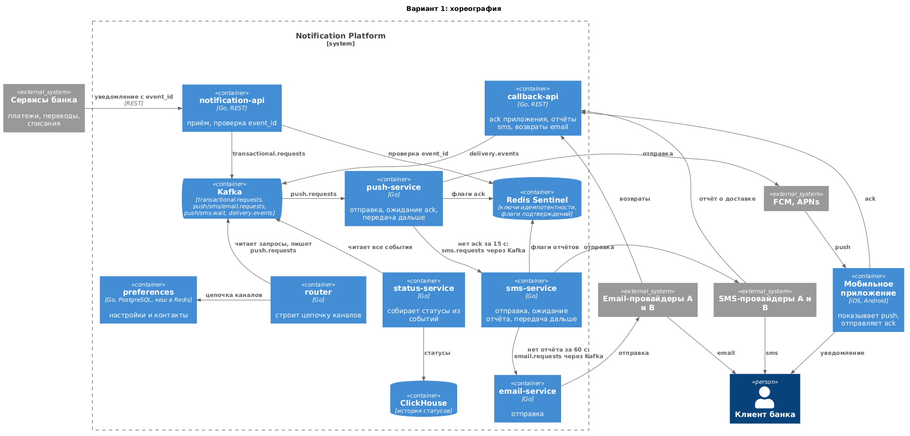
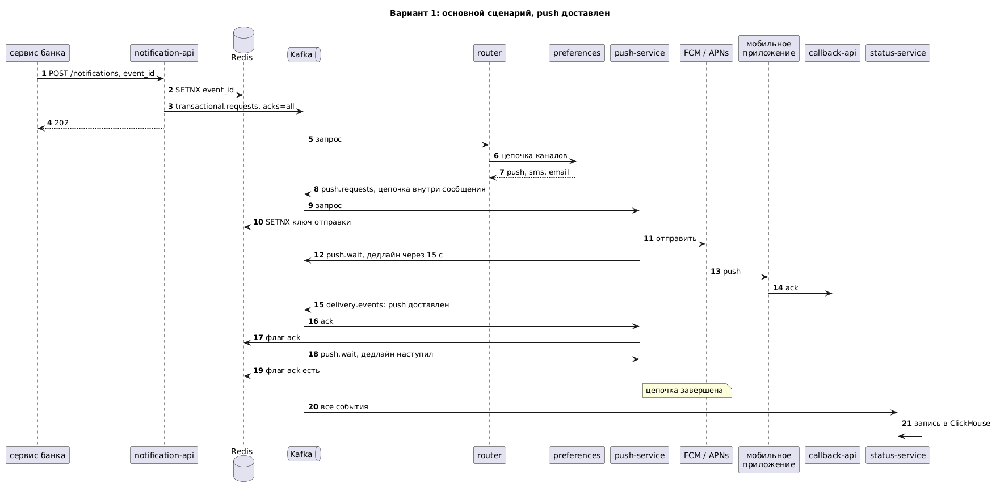
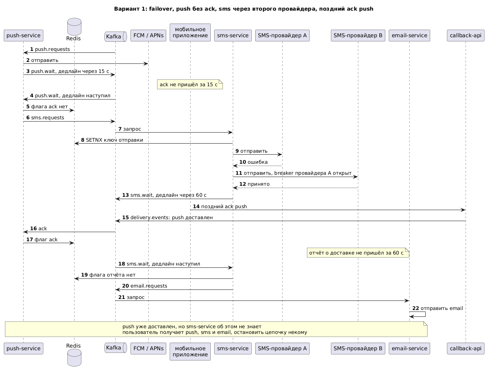
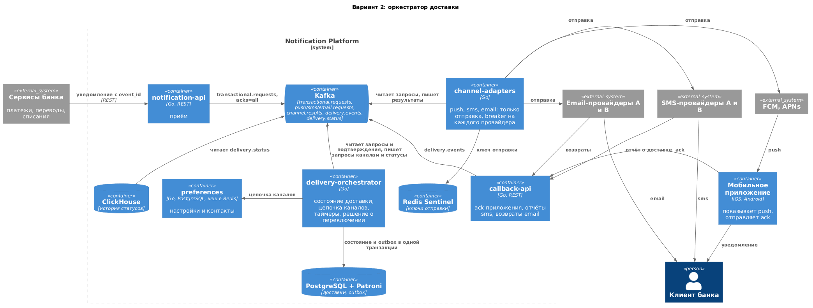
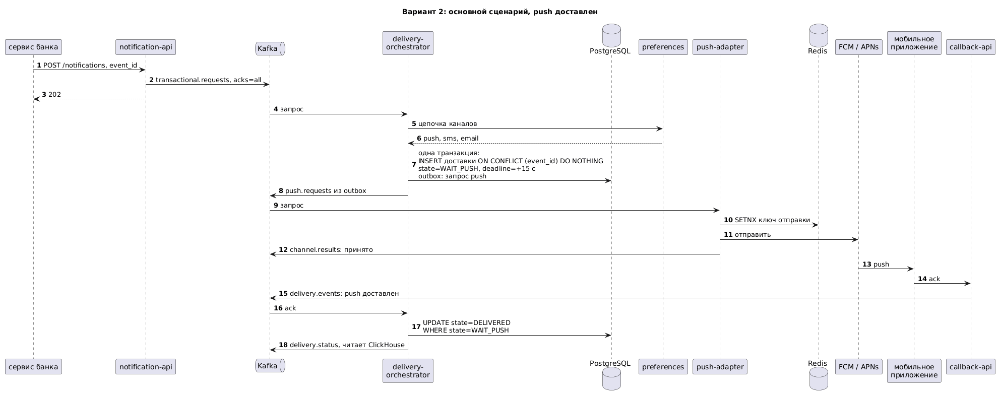
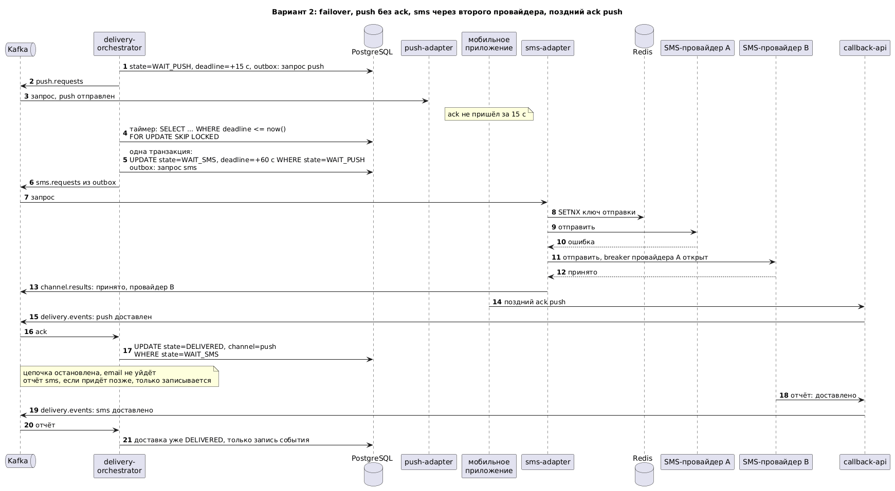

# Notification Platform

централизованная платформа уведомлений онлайн-банка: через неё все команды отправляют транзакционные, сервисные и маркетинговые уведомления по push, sms и email

правила, принятые в работе:

- транзакционные отключить нельзя, пользователь выбирает только предпочтительный канал: push или sms
- сервисные можно отключить по каждому каналу
- маркетинговые уходят только тем, кто дал согласие, и отключаются целиком или по каналам

## 1. Функциональные требования (ФТ)

1) единый приём: любой сервис банка отправляет уведомление в платформу, канал выбирает платформа, цель: централизованный контроль
2) гарантированная доставка: транзакционное уведомление доходит хотя бы по одному каналу, при сбое канала платформа отправляет по следующему, цель: гарантированная доставка критичных
3) настройки: пользователь выбирает предпочтительный канал и отключает сервисные и маркетинговые уведомления, цель: меньше жалоб, выше retention
4) без дублей: одно событие доходит по одному каналу один раз, цель: меньше жалоб
5) статус: отправитель и поддержка видят, доставлено ли уведомление и по какому каналу, цель: централизованный контроль

## 2. Нефункциональные требования

- НФТ1 задержка транзакционных: p95 ≤ 5 с по первому каналу, p99 ≤ 90 с с переключением
- НФТ2 нагрузка: до 3 000 уведомлений/с, из них 1 000 транзакционных/с, расчёт в 8.3
- НФТ3 надёжность: 0 потерь принятых транзакционных, доставлено ≥ 99,9%, доступность приёма ≥ 99,95% в месяц
- НФТ4 провайдеры: при отказе провайдера sms или email переход на второго ≤ 30 с без потерь
- НФТ5 стоимость: по sms ≤ 30% транзакционных

## 3. Архитектурно значимые требования

ASR1 гарантированная доставка транзакционных, приоритет высокий

- требования: ФТ2, НФТ3, НФТ4
- почему влияет: уведомление надо хранить до подтверждения и переключать каналы, нужны хранилище состояния и компонент, который отвечает за итог

ASR2 низкая задержка при массовых кампаниях, приоритет высокий

- требования: НФТ1, НФТ2
- почему влияет: кампания не должна задерживать транзакционные, нужны раздельные очереди и ресурсы по типам

ASR3 без дублей, приоритет высокий

- требования: ФТ2, ФТ4
- почему влияет: и внутри системы, и у провайдеров доставка идёт как минимум один раз, нужны ключи идемпотентности и одно место, где решается переключение

ASR4 наблюдаемость, приоритет средний

- требования: ФТ5
- почему влияет: уведомление проходит много сервисов и провайдеров, нужны сквозной id, журнал статусов и метрики

## 4. Ключевые архитектурные вопросы

В1 как понять, что уведомление доставлено, и когда считать канал отказавшим

- порождают: ASR1, ASR3, НФТ1
- почему важен: push не даёт надёжного подтверждения доставки, sms подтверждается с задержкой, от ответа зависит таймаут переключения, а значит баланс между задержкой, дублями и стоимостью

В2 как передавать уведомления между компонентами: синхронно или через брокер, одной очередью или раздельно по типам

- порождают: ASR1, ASR2, НФТ2
- почему важен: определяет, теряются ли уведомления при сбое, мешает ли кампания транзакционным и как система масштабируется

В3 где принимается решение о переключении канала: в одном компоненте или в каждом сервисе канала

- порождают: ASR1, ASR3, ASR4
- почему важен: от этого зависит, кто отвечает за итог доставки, можно ли остановить цепочку при позднем подтверждении и где смотреть состояние

## 5. Архитектурные последствия ASR

1) ASR1 гарантированная доставка: ответ отправителю только после записи в брокер, состояние доставки в базе до финала, подтверждения от приложения и провайдера, цепочка каналов с таймаутами, по два провайдера sms и email, общий срок доставки с алертом
2) ASR2 низкая задержка: асинхронная обработка через брокер, отдельные очереди и ресурсы по типам уведомлений, настройки пользователя из кеша
3) ASR3 без дублей: ключ идемпотентности от отправителя, ключ отправки перед вызовом провайдера, решение о переключении в одном компоненте, поздние подтверждения останавливают цепочку
4) ASR4 наблюдаемость: сквозной notification_id, журнал статусов в отдельном хранилище, метрики и алерты по каналам и провайдерам

## 6. Неподходящие решения

Синхронная отправка: сервис-отправитель или платформа вызывает провайдера прямо в обработке запроса

- нарушает: ASR1, ASR2
- почему: при сбое провайдера уведомление теряется или отправитель ждёт таймаут, повторы ложатся на каждую команду, медленный провайдер увеличивает задержку и держит потоки

Одна общая очередь для всех типов

- нарушает: ASR2
- почему: кампания на 1 млн ставит миллион сообщений перед подтверждением перевода, транзакционное ждёт минуты

## 7. Неопределённости и архитектурные риски

Какая доля push реально доходит и подтверждается приложением

- что неизвестно: ios и android ограничивают работу приложения в фоне, ack может не прийти при доставленном push, тогда платформа зря отправит sms, будут дубли и лишние траты
- как проверить: пилот на 5% пользователей с ack, сравнить долю ack с отчётами fcm и apns, подобрать таймаут по распределению времени ack

Насколько надёжны sms-провайдеры

- что неизвестно: реальная задержка, доля отчётов о доставке, лимиты скорости, частота сбоев
- как проверить: нагрузочный тест в тестовом окружении провайдеров на 3× пиковую скорость, история инцидентов за год, sla в договоре, мониторинг доли ошибок после запуска

## 8. RFC: гарантированная доставка транзакционных уведомлений с переключением каналов

### 8.1 Требования к подсистеме

функциональные, уточняют ФТ2, ФТ3, ФТ4 и ФТ5:

- Т1 цепочка каналов: предпочтительный канал, затем второй из push и sms, затем email, без push-токена цепочка начинается с sms
- Т2 подтверждение: push доставлен, когда пришёл ack от приложения, sms по отчёту провайдера, email по приёму провайдером
- Т3 переключение: нет ack push за 15 с, переход к sms, нет отчёта sms за 60 с или ошибка у обоих провайдеров, переход к email
- Т4 повтор от отправителя с тем же event_id не создаёт новую доставку
- Т5 позднее подтверждение любого канала завершает доставку, следующие каналы не отправляются
- Т6 транзакционные отключить нельзя
- Т7 по каждой доставке видны текущий шаг, все попытки и итог

нефункциональные, уточняют НФТ1, НФТ3, НФТ4 и НФТ5:

- задержка: p95 ≤ 5 с по первому каналу, p99 ≤ 90 с с переключением
- надёжность: 0 потерь после ответа 202, хотя бы по одному каналу доставлено ≥ 99,9%
- дубли: повтор по одному каналу ≤ 0,01%, доставка и push и sms одного уведомления ≤ 1% от переключений
- стоимость: по sms ≤ 30% транзакционных
- наблюдаемость: статус виден за 10 с, алерт, если доставка не завершилась за 3 минуты

### 8.2 ASR и приоритеты

| приоритет | ASR | откуда |
|---|---|---|
| P1 | гарантированная доставка хотя бы по одному каналу | ASR1, Т1-Т3 |
| P1 | без дублей при повторах и переключении | ASR3, Т4, Т5 |
| P1 | задержка транзакционных | ASR2 |
| P2 | минимальная стоимость, sms только при отказе push | НФТ5, Т1 |
| P2 | наблюдаемость каждой доставки | ASR4, Т7 |
| P3 | масштабирование | НФТ2, транзакционных в 5 раз меньше всех уведомлений |

### 8.3 Расчёт нагрузки

допущения:

- уведомления в день считаются на DAU: 3 млн × 2 транзакционных
- пиковый час: 10% суточного объёма, это доля PCU от DAU, 300 тыс из 3 млн
- всплеск в зарплатные дни и распродажи: ×3 к пиковому часу
- push-токен есть у 85% пользователей, ack за 15 с приходит в 90% случаев
- sms стоит 2,5 руб

| величина | расчёт | значение |
|---|---|---|
| транзакционных в сутки | 3 млн × 2 | 6 млн |
| в среднем | 6 млн / 86 400 | ~70/с |
| пиковый час | 600 тыс / 3 600 | ~170/с |
| всплеск | 170 × 3 | ~500/с |
| закладываемая мощность | всплеск × 2 | 1 000/с |
| доставлено по push | 0,85 × 0,9 | 76,5% |
| ушло в sms | 1 - 0,765 | 23,5%, ~1,4 млн в сутки |
| sms на всплеске | 500 × 0,235 | ~120/с, каждый провайдер должен держать ≥ 150/с один |
| записей в postgresql для варианта 2 | 1 000/с × ~6 записей на доставку | ~6 000/с |
| стоимость каскада | 1,4 млн × 2,5 руб | ~3,5 млн руб в сутки, ~105 млн в месяц |
| стоимость при sms на всё | 6 млн × 2,5 руб | ~15 млн руб в сутки, ~450 млн в месяц |

выводы: каскад с push первым дешевле sms на всё примерно в 4 раза, один primary postgresql на nvme выдерживает порядка 10-20 тыс простых записей в секунду, это запас ×2-3 к расчётной мощности

### 8.4 Вариант 1: хореография

общего управляющего сервиса нет, каждый сервис канала сам решает, что делать дальше

1) notification-api принимает уведомление, кладёт его в kafka и отвечает 202, когда kafka сохранила сообщение
2) router берёт у preferences порядок каналов и отправляет уведомление первому каналу
3) сервис канала отправляет уведомление и ждёт подтверждения: ack от приложения для push, отчёт провайдера для sms
4) если подтверждения нет за 15 с для push или 60 с для sms, сервис сам передаёт уведомление следующему каналу
5) ожидание сделано отдельными топиками kafka, потому что kafka не умеет откладывать сообщения
6) подтверждения приходят в callback-api, отметки о них хранятся в redis
7) у sms и email по два провайдера, при сбое одного отправка идёт через другого
8) статусы собирает status-service в clickhouse

как вариант выполняет ASR:

- гарантированная доставка, частично: за итог доставки никто не отвечает, уведомление, потерянное между сервисами, никто не заметит
- без дублей, частично: каждый сервис знает только свой шаг, поздний ack push не останавливает sms и email
- задержка, да: лишних шагов нет
- стоимость, частично: после позднего ack цепочка продолжается и тратит sms
- наблюдаемость, частично: статус собирается из событий разных сервисов, где застряло уведомление, видно плохо
- масштабирование, да: каждый сервис масштабируется отдельно

технологии: go, kafka, redis, postgresql для настроек, clickhouse, fcm и apns, prometheus, grafana, jaeger

### 8.5 Вариант 2: оркестратор доставки

один сервис, delivery-orchestrator, хранит состояние каждой доставки и решает, куда отправлять дальше, сервисы каналов только отправляют

1) notification-api кладёт уведомление в kafka и отвечает 202, когда kafka сохранила сообщение
2) оркестратор создаёт запись доставки в postgresql, повтор с тем же event_id отбрасывается
3) состояния доставки: WAIT_PUSH, WAIT_SMS, EMAIL_SENT, DELIVERED, FAILED
4) смена состояния и задание для канала пишутся в базу одной транзакцией, отдельный поток пересылает задания в kafka, поэтому задание не теряется при падении сервиса
5) у записи есть срок ожидания, оркестратор раз в 200 мс находит просроченные и переключает канал
6) состояние меняется только из ожидаемого, поэтому подтверждение и таймаут не сработают одновременно
7) поздний ack push завершает доставку, sms и email больше не отправляются
8) если оба провайдера канала отказали, следующий канал запускается сразу, без ожидания
9) доставка, не завершённая за 3 минуты, становится FAILED, приходит алерт
10) сервис канала перед отправкой ставит ключ в redis, повторное задание из kafka не вызовет провайдера второй раз
11) у sms и email по два провайдера, при сбое одного отправка идёт через другого
12) история статусов в clickhouse, за 90 дней это больше 1,5 млрд строк, метрики в prometheus и grafana: доля доставленных по каналам, время доставки, доля переключений и двойных доставок, ошибки провайдеров, трейсы в jaeger по notification_id

как вариант выполняет ASR:

- гарантированная доставка, да: состояние в базе до финала, за итог отвечает оркестратор, зависшие ловит общий срок
- без дублей, да: event_id уникален, ключ перед отправкой, решение о переключении в одном месте
- задержка, да: лишний шаг добавляет десятки миллисекунд
- стоимость, да: sms и email не отправляются после подтверждения
- наблюдаемость, да: текущее состояние в postgresql, история в clickhouse
- масштабирование, да до ×2-3 от расчёта, дальше деление базы по user_id

технологии: go, kafka, postgresql с patroni для доставок, redis для ключей отправки и кеша настроек, clickhouse, fcm и apns, prometheus, grafana, alertmanager, jaeger

### 8.6 Сравнение и выбор

| ASR | приоритет | вариант 1 | вариант 2 |
|---|---|---|---|
| гарантированная доставка | P1 | частично, нет владельца итога | да |
| без дублей | P1 | частично, цепочка не останавливается | да |
| задержка | P1 | да | да, плюс десятки мс |
| стоимость | P2 | частично | да |
| наблюдаемость | P2 | частично | да |
| масштабирование | P3 | да, без центральной базы | да до ~×3 от расчёта, дальше шардирование |

выбран вариант 2, потому что:

- он полностью закрывает все требования P1, вариант 1 закрывает гарантированную доставку и дубли только частично
- в нём есть один компонент, отвечающий за итог доставки, а гарантированная доставка и есть главное требование
- главный плюс варианта 1, независимое масштабирование без центральной базы, здесь не нужен: транзакционных до 1 000/с, одна база postgresql их держит
- новых технологий нет, те же kafka, postgresql и redis

### 8.7 Компромиссы и ограничения

- центральная база: при переключении primary postgresql на реплику, до 30 с, новые доставки ждут в kafka, потерь нет, но задержка в этот момент выше sla
- потолок одной базы: при росте больше ×2-3 от расчёта нужно шардирование доставок по user_id
- поздний ack: если ack push придёт после отправки sms, пользователь получит оба, меньше таймаут, больше двойных доставок и трат, больше таймаут, дольше ждать при отказе push, 15 с выбрано как стартовое значение и уточняется по пилоту, цель ≤ 1% двойных от переключений
- email подтверждает только приём провайдером, а не прочтение, поэтому он последний в цепочке
- ровно одной доставки не будет: провайдер может доставить и не прислать отчёт, гарантия только хотя бы одна доставка
- пользователь без единого рабочего контакта уведомление не получит, доставка уходит в FAILED и в поддержку
- для ack нужна доработка мобильного приложения
